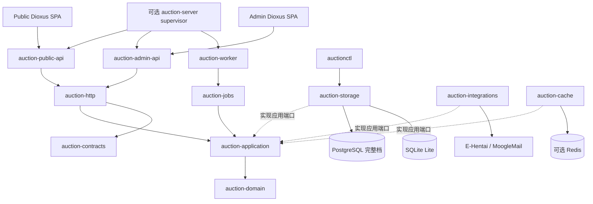

# Auction Rust 系统设计

[项目首页](README.md) · [文档导航](docs/README.md) · [Public 设计](crates/auction-web-public/DESIGN.md) · [Admin 设计](crates/auction-web-admin/DESIGN.md)

本页说明系统协作与核心数据流。模块与档位由[架构](docs/architecture.md)维护，精确 wire/数据语义由
[契约](docs/contracts/README.md)维护；源码、制品和运行证据的区别见[状态页](docs/status.md)。
Public/Admin 的布局与交互分别维护，不在本页复制界面或契约清单。

## 1. 设计目标

将公开竞价、管理、论坛、邮件、结算和履约组织为可恢复的全 Rust 系统：领域独立于传输和存储，
业务事实原子提交，命令可幂等重放，外部结果有证据，Worker 可从持久化状态继续。能力缺失明确返回，
不以空数据或示例数据冒充成功。缓存只加速可重建读取。

## 2. 系统拓扑



浏览器箭头表示请求，虚线表示适配器实现应用端口。编译依赖向内，装配根实例化并注入适配器；
应用不导入具体存储，领域不读配置、不执行 SQL 或网络请求。

## 3. 进程边界

Public/Admin 各有 API、会话和页面入口，Worker 运行持久任务并可提供本机 Unix control；
`auctionctl` 是不监听的运维工具。默认监听和入口见[项目首页](README.md#运行边界)。
可选 server 在 Linux/PostgreSQL 单机下派生三角色，保留独立路由及状态机；默认分体发布不变，
两种模式不得混用同一数据库。

## 4. 分层与 crate 所有权

领域拥有规则与计算；应用拥有用例和端口；适配器拥有 SQL/外部协议；HTTP、Web、Worker 各自交付。
每张表、路由、事件和外部写入只有一个 owner，完整映射见[架构 owner 表](docs/architecture.md#crate-所有权)。
跨层经窄端口，不访问其他 crate 私有持久化，不用共享大结构体或第二套状态机绕过边界。

## 5. 核心领域模型

### 5.1 世界、用户和身份

`worlds` 是业务启停门禁；用户拥有可变显示名/MoogleMail 收件人、稳定论坛数字 `showuser` ID、状态和版本。
论坛首次竞价可建立 `forum_only` 主体，但不自动发放登录能力。Public/Admin 会话真值在数据库，
登录 Key、Cookie 与密钥遵守各自敏感边界，Redis 不持有会话权威状态。

### 5.2 拍卖与拍品

```text
Draft → Preview → Live → Final → Settling → Settled
Draft / Preview → Cancelled
```

已开放拍卖不能取消以绕过收口/结算。创建时冻结经济、截止、代理和结算策略，后续配置不回写快照。
`lot_id` 是稳定身份，`lot_number` 是场内内部顺序，`category_key/category_number` 是对外分类编号；
撤回/重挂不复用编号。`withdrawn` 保留事实和返还义务，但不进入公开竞价或论坛目录；论坛只渲染
可公开的 `live/sold/unsold` 拍品。

### 5.3 竞价与代理

普通出价、代理上限及慢速代理共用领域计划。新输入遵守 1000 Credits 网格和 1B 上限，历史金额不截断。
授权、降低、冻结和反超以追加转换事实表达；慢速代理由持久化 generation/due 驱动，执行时仍在锁内
复核资格、状态和金额。完整金额、阶段、代理及结算规则见[不变量](docs/contracts/invariants.md)。

## 6. 写入与事务设计

```text
command_id + 摘要 → 账本重放/冲突 → 锁定权威对象 → 领域计划
                                                    ↓
                  同事务提交事实、版本、结果、审计及所需事件/outbox
                                                    ↓
                              返回结果 / Worker 执行外部副作用
```

同 ID/同摘要重放原结果，不按新配置重新计算；同 ID/不同负载冲突。不能先返回成功再补审计或账本，
外部未知结果不能直接重发。runtime 文件更新另有[向前恢复边界](#9-配置安全和缓存)。

### PostgreSQL

竞价和关键生命周期使用 Serializable、明确行锁，冲突最多尝试 3 次（含首次）。队列领取可用
Read Committed 加锁/条件更新；具体锁序、账本和事实要求见[事务不变量](docs/contracts/invariants.md)。

### SQLite Lite

使用 `BEGIN IMMEDIATE`、WAL、busy timeout 和本地文件；每角色至多一个实例、Worker 并发 1。
已支持能力仍需完整幂等及原子性；不模拟 PostgreSQL 行锁或完整档系统能力。

## 7. Worker 与外部副作用

Worker 拥有执行时机与恢复编排，数据库拥有 due、cursor、attempt、lease、fencing 和结果。
生命周期、慢速代理、结算、邮件、履约、论坛、实时消费和告警循环各有预算及失败边界；
单项失败不终止其他 owner，循环任务异常退出则失败关闭，详见[Worker](apps/worker/README.md)。

### E-Hentai 论坛

发布主题、完整读取、导入回帖形成持久流程；固定 #1 目录和 #2 系统日志的真实 post ID 保存后才处理 #3+。
读取须证明分页、帖子/作者与连续楼层，回帖只导入普通 bid。未知 POST 先按精确标题只读对账，重发须显式授权。
BBCode 装备链接经受控解析，不把明文 key 放快照、日志或审计。完整证明见[外部适配](crates/auction-integrations/README.md)。

### MoogleMail

integrations 拥有协议解析，Worker 持久化 delivery 状态。ComposeSend 先验证空 compose 与全量 Sent baseline，
再独立查找唯一新增且精确匹配 payload 的 MID；Take/Return 使用各自动作证明。无法证明则人工对账，禁止盲发。
每种 Cookie 有唯一运行 owner，明确登录失效才标 invalid，不自动换备用 Cookie；详见[邮件不变量](docs/contracts/invariants.md)。

## 8. HTTP、实时与浏览器

### HTTP

Public/Admin 分别注册 feature API，使用统一业务 envelope。严格解码、body 限制、Origin、认证/CSRF、
版本和命令检查由 HTTP 边界执行；处理器只映射 DTO。路径、字段、状态码与安全预算见[HTTP 契约](docs/contracts/routes.md)。

### 实时

Public 使用 WebSocket v1 和 HTTP Catch-up，推送已提交事实的重读提示，不接收业务命令。
`event_id`、stream sequence、schema version 和实体 version 各有语义，跳号/坏事件/重连回到权威快照。
relay 游标与失败持久化，Hub 有界；当前无 SSE 或外部广播 sink，详见[事件契约](docs/contracts/events.md)。

### Public：公开竞价界面

以找装备、理解价格/截止时间、明确出价和恢复读取为核心，独立拥有世界选择、连接及 Public 会话。
页面与交互见 [Public 设计](crates/auction-web-public/DESIGN.md)。

### Admin：管理与运维界面

以查询、版本化管理、配置、诊断和人工对账为核心。管理会话先于页面加载，首次 `/setup` 属于独立设置服务。
页面与交互见 [Admin 设计](crates/auction-web-admin/DESIGN.md)。

### 共享基础与隔离规则

两端是独立 Dioxus CSR，拥有各自路由、API 消费、样式及译文；共享层只提供设计变量、基础组件、传输、
格式化、安全 Markdown 与语言机制。业务字段、列宽、文案、权限和命令草稿由各 surface 持有。
同名路径不共享权限或页面，合并制品也由不同角色/router 提供资源。
五语言与 `hv.lang` 规则见[协作规范](AGENTS.md#web-规则)，窄屏表格见[布局契约](docs/table-layouts.md)。

## 9. 配置、安全和缓存

公共、角色、敏感 TOML 分离，Admin/Worker 可共享 runtime；`AUCTION_CONFIG_FILE` 只选择角色文件。
runtime 用 fingerprint、文件锁、持久账本和原子替换保存；替换后确认失败向前恢复，保存后重启才生效。
秘密不进入普通投影，详见[配置](ops/config/README.md)。
P09/P11 经归属复核短暂解密装备 URL，仅以 `no-store` 返回，Lite 链接为空。
缓存默认关闭，只缓存可重建规则读取，失败回源；资格、锁、账本、会话与审计始终由权威存储决定。

## 10. 部署与生命周期

### 分体部署

`auctionctl deployment start/restart` 严格停机后迁移，再按 Worker → Admin → Public 启动，反向停止。
已全部运行的 start 只复核 readiness/回执；普通角色启动不迁移。详细门禁见[部署手册](ops/deploy/README.md)。

### 首次设置

一次性部署码保护独立设置页；检查数据库不建库/迁移，保存只表示配置落盘。合并模式额外确认专用空库初始化与启动。
初始化复用迁移兼容视图、锁和 checksum；失败或结果未知保留现场，禁止盲目重试。
Admin 启动永久撤销旧管理会话并将 token 摘要绑定当前 actor/secret，重启需重新登录。

### 关闭

首次 SIGINT/SIGTERM 停止接收/领取并开始有界 drain，第二次信号或超时强制收口。
装配根负责心跳、readiness、tracing 与 control 的停止次序，详见[进程原语](crates/auction-process/README.md)。

## 11. 能力档位

PostgreSQL 提供完整事实链；Lite 仅支持声明子集，并保持这些写入的正确性。
精确差异统一维护在[能力矩阵](docs/architecture.md#部署档位与能力)，不从路由存在推导后端支持。

## 12. 当前状态与未闭合验证

[状态页](docs/status.md)统一记录源码能力、历史检查、有限部署证据与未验证事项。
默认入口 `just verify` 只做[静态验证](docs/development.md)；行为测试、真实外部流程和切换须明确授权。
源码修改、WASM 构建、宿主重编和线上替换是不同步骤，不能互相替代。

## 13. 变更规则

先登记契约/能力及 owner，再依次实现领域、应用端口、适配器和 HTTP/Web/Worker；同步设计、模块说明与运维文档。
执行适用静态门禁，授权行为验证另行保留证据。具体规则见 [AGENTS.md](AGENTS.md) 与[文档维护](docs/documentation.md)。
