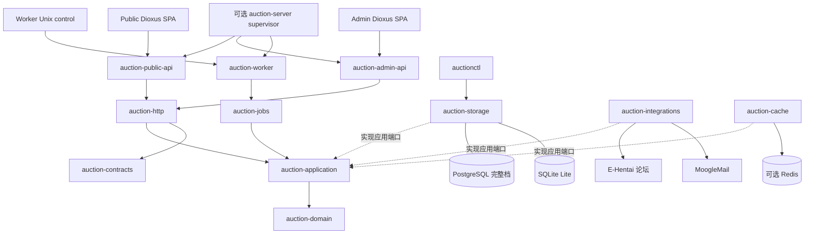

# Auction Rust 系统设计

[项目首页](README.md) · [文档导航](docs/README.md) · [Public 设计](crates/auction-web-public/DESIGN.md) · [Admin 设计](crates/auction-web-admin/DESIGN.md)

> 核对日期：2026-10-13。本文描述当前工作区的系统设计，不代表对应源码已经部署或完成运行验收。
> 路由、事件、数据库对象和不变量以 [契约](docs/contracts/README.md) 为准；模块 owner 以
> [架构](docs/architecture.md) 为准；实现与证据分别登记在 [状态说明](docs/status.md)。

本文负责系统边界、核心数据流与设计约束。Public 与 Admin 的页面、布局、交互和样式分别由两份独立
`DESIGN.md` 维护，不在总览中合并成同一个应用外壳，也不重新定义既有业务或视觉契约。

## 1. 设计目标

Auction Rust 是面向论坛生态的全 Rust 拍卖系统，目标是把公开竞价、管理操作、论坛同步、MoogleMail 处理、结算和履约组织成可恢复的持久化系统。

核心目标：

- 领域规则与数据库、HTTP、外部网站解耦；
- 所有可变命令具备稳定 `command_id`、幂等账本和可审计结果；
- 竞价、生命周期和结算事实在数据库事务内原子提交；
- 外部网站写入只发生在本地提交之后，并以远端证明区分成功、失败和未知；
- Worker 重启、崩溃或多次执行后仍可从持久化游标、租约和事实继续；
- PostgreSQL 提供完整生产能力，SQLite 提供明确受限的单机 Lite 能力；
- Public、Admin 的浏览器端保持独立，使用 Dioxus CSR 和版本化 REST/WebSocket 契约；
- 能力缺失必须显式返回，不使用空数据或示例数据伪装成功。

以下事项不属于当前设计：React/TypeScript/npm 运行时、SSR/hydration、第二套 HTTP 服务、`sqlx::Any`、缓存承载权威状态、未登记的 SSE 或外部广播 sink。

## 2. 系统拓扑



浏览器到进程的箭头表示请求，适配器到应用层的虚线表示实现应用端口，不表示由应用层导入具体适配器。
编译依赖方向向内：装配根实例化并注入适配器，应用层通过窄端口调用，领域层不读取配置、不执行 SQL、不访问网络。

## 3. 进程边界

| 进程 | 默认边界 | 主要职责 |
| --- | --- | --- |
| `auction-public-api` | `127.0.0.1:8090` | Public REST、Public session、WebSocket、公开页面和实时 relay |
| `auction-admin-api` | `127.0.0.1:8091` | Admin REST、Admin session、管理页面、配置与运维查询 |
| `auction-worker` | 无业务 TCP；可选 Unix control | 生命周期、慢速代理、结算、邮件、论坛、履约、恢复和告警 |
| `auctionctl` | 无监听 | 配置诊断、迁移、部署总控、备份/恢复和人工对账命令 |
| `auction-server` | 可选 Linux/PostgreSQL 单机 supervisor | 以一个父进程派生上述三个角色；不合并业务路由或状态机 |

默认发布保持分体部署。合并 supervisor 只适用于同一主机、同一服务账号和专用 PostgreSQL 环境，不能与分体部署混用同一数据库。

## 4. 分层与 crate 所有权

| 层 | crate | 设计职责 |
| --- | --- | --- |
| 领域 | `auction-domain` | 金额、身份、竞价计划、代理状态机、拍卖状态和结算守恒 |
| 应用 | `auction-application` | 用例、事务顺序、命令幂等、审计上下文和窄端口 |
| 契约 | `auction-contracts` | REST DTO、WebSocket v1、分页、错误和版本化 wire |
| 持久化 | `auction-storage` | SQL、迁移、连接池、事务、锁、命令账本和后端差异 |
| 外部适配 | `auction-integrations` | E-Hentai、MoogleMail、装备来源、凭据和协议证明 |
| 调度 | `auction-jobs` | durable due、游标、claim、lease、重试、Worker control |
| HTTP | `auction-http` | Public/Admin 路由、认证、安全边界、DTO 映射和静态资源 |
| 浏览器 | `auction-web-public` / `auction-web-admin` | 两个独立 Dioxus CSR surface、页面、交互和五语言译文 |
| 共享 Web | `auction-web-shared` | 无业务偏向的设计变量、基础组件、格式化和语言偏好 |
| 配置 | `auction-config` | TOML 读取、默认值、校验、cron、runtime 文件和敏感边界 |
| 可观测性 | `auction-observability` | tracing、metrics、health、heartbeat 和安全状态投影 |
| 进程 | `auction-process` | 信号、drain、任务守卫和退出边界 |
| 首次设置 | `auction-setup` | PostgreSQL 单机首次设置页、部署码和显式初始化门禁 |
| 装配根 | `apps/*` | 配置加载、依赖注入、监听器、资源绑定和退出码 |

每张表、每条路由、每种事件和每个外部写入只有一个 owner。跨层访问必须经过窄端口，不共享大结构体绕过边界。

## 5. 核心领域模型

### 5.1 世界、用户和身份

- `worlds` 是业务世界边界，也是启停和新业务进入的权威门禁。
- `users` 拥有可变 MoogleMail 收件人/显示名称、稳定论坛数字账号 ID、状态和版本。
- `public_sessions`、`admin_sessions` 保存会话真值；Redis 不能替代会话存储。
- 用户登录 key、论坛 Cookie、MoogleMail Cookie、数据库密码和数据密钥只存在于受控敏感边界。

论坛数字账号 ID 与可变用户名分离：`showuser` 数字 ID 用于稳定身份归属，用户名用于 MoogleMail 收件人和页面显示。论坛首次竞价可以建立没有 active key 的 `forum_only` 主体，但不会自动授予登录能力。

### 5.2 拍卖与拍品

拍卖生命周期由领域状态机集中维护：

```text
Draft → Preview → Live → Final → Settling → Settled
   └──────────────→ Cancelled
```

取消只允许在 Draft/Preview，已开放拍卖不能通过取消绕过竞价收口和结算。拍卖创建时冻结经济、软截止、取消截止、代理和结算策略；后续配置不回写历史快照。

拍品同时拥有：

- `lot_id`：写入和详情查询的稳定身份；
- `lot_number`：场次内不可变的内部顺序；
- `category_key/category_number`：分类内对外编号，例如 `One01`、`Shield01`、`Cloth01`；撤回或重挂不复用编号；
- 状态、当前价、领先者、版本和有效结束时间。

`withdrawn` 表示已撤拍。它保留历史事实和返还义务，但不进入当前公开竞价目录，也不进入论坛拍卖快照；论坛目录当前只渲染可公开的 `live`、`sold`、`unsold` 拍品。

### 5.3 竞价与代理

普通出价、代理上限和慢速代理都调用同一领域竞价计划，不由 HTTP 或 Worker 复制状态机。新输入遵守 1000 Credits 网格和 1B 上限；历史金额和历史事实不被静默截断。

代理授权及其降低、冻结、自动反超使用追加式转换事实。慢速代理由 lot 上的 generation/due 字段驱动，Worker 只负责发现到期候选，最终资格、状态和金额仍在竞价事务内重新校验。

## 6. 写入与事务设计

数据库业务写命令遵循以下模式；runtime 文件更新另有文件与账本的向前恢复边界，见第 9 节：

1. 接收稳定 `command_id` 和请求摘要；
2. 在事务内查找账本，判定原结果重放或负载冲突；
3. 按对应存储 owner 的锁顺序保护权威对象；竞价涉及 world、auction、lot、资格与代理；
4. 在领域层校验状态、资格、版本、金额和策略；
5. 在同一事务写入业务事实、状态版本、安全结果账本、追加审计及该命令要求的实时事件/outbox；
6. 提交成功后返回结果；不能先返回成功，再补写命令账本或审计；
7. Worker 只在本地提交之后领取持久任务，执行论坛、邮件等外部副作用。

相同 `command_id` 与相同摘要必须重放原结果；相同 ID 搭配不同负载必须冲突。未知提交结果不能自动重放可能已成功的外部写入。

### PostgreSQL

- 竞价和关键生命周期使用 Serializable 与明确行锁；序列化冲突最多重试三次。
- 队列领取可使用 Read Committed，但必须有显式锁、唯一约束或条件更新。
- 结算、恢复、规则发布、world 启停和管理 mutation 继续沿用同一原子审计边界。

### SQLite Lite

- 使用 `BEGIN IMMEDIATE` 串行写事务、WAL、本地文件和 busy timeout。
- 每个角色至多一个实例，Worker 并发固定为一。
- 不模拟 PostgreSQL 行锁，也不声明结算、论坛、邮件、凭据等完整档能力。
- 已声明支持的竞价、会话、审计和实时读取仍必须保持幂等与原子性。

## 7. Worker 与外部副作用

Worker 不拥有第二套拍卖状态机，只负责“何时执行”和“失败后如何继续”。due、游标、attempt、lease、fencing、失败原因和命令结果全部持久化。

主要循环：

- 拍卖生命周期、慢速代理和 PostgreSQL 结算；
- MoogleMail 入站轮询、拍卖邮件解析、用户注册/重绑；
- delivery outbox、履约和 recovery；
- E-Hentai 主题发布、固定帖刷新和论坛回帖导入；
- realtime consumer、operations alert 和健康投影。

每类循环独立 cadence、批次、并发、deadline 和失败边界。单项失败不能终止其他 owner；循环任务异常退出才使 Worker 失败关闭。

### E-Hentai 论坛

论坛同步采用“发布主题 → 读取完整主题 → 导入回帖”的持久化流程：

- 固定 `#1` 是拍卖目录，固定 `#2` 是系统日志；两个真实 post ID 持久化后才处理 `#3+`；
- 主题读取按真实分页、帖子 ID、作者 `showuser` 和连续楼层校验，解析失败不使用部分结果；
- 未知 POST 结果先按精确标题只读对账；未命中必须由 `auctionctl` 明确授权后才能再次 POST；
- 回帖只导入普通 `bid`；代理命令由 Public Web 专属，`start`、`cancel` 等未登记动作不会写入拍卖；
- 论坛来源通过真实楼层与帖子身份记录，不能从楼层号或用户 ID 推导 URL；
- #1/#2 正文更新和同步水位使用独立 lease/fencing，并由完整主题扫描证明连续处理楼层。

论坛渲染器生成紧凑 BBCode，分类之间保留足够间距；装备名称链接在渲染前经受控装备链接边界解析，明文 key 不进入快照、日志或审计。

### MoogleMail

MoogleMail 的读取、发送、Take、Return 和 Sent/Balance 对账由 integrations 拥有协议解析，由 Worker 拥有 durable delivery 状态。

主动 ComposeSend 必须：

1. 发送前证明 compose 页面为空且读取全量 Sent baseline；
2. POST 后独立扫描 Sent；
3. 只接受唯一新增、收件人/主题/正文摘要/Credits/COD/装备完全匹配的 MID；
4. 无法证明时进入 `manual_reconcile`，禁止盲目重发。

Return/Take 使用独立动作证明。凭据按 Cookie 类型取得进程级 owner；远端明确登录失效才标记 Cookie 无效，不自动切换第二条 Cookie。

## 8. HTTP、实时与浏览器

### HTTP

Public 与 Admin 分别注册自己的 feature API；完整路径、方法与数量以 [HTTP 契约](docs/contracts/routes.md) 为准。
业务响应使用：

```json
{"code":"...","message":"...","data":...}
```

JSON 请求拒绝未知字段、尾随值、错误媒体类型和超限 body。mutation 经过请求 ID、限流、Origin、认证/CSRF、版本和命令校验；处理器只做契约映射，不实现领域规则。

### 实时

Public 使用 WebSocket v1 + `GET /api/v1/events` Catch-up：

- 事件拥有独立的 `event_id`、stream sequence、schema version 和 payload；
- 状态版本不等同于流序号；
- 跳号、坏事件或 `refetch_required` 时回到权威快照；
- WebSocket 只推送已提交事件，不接收业务命令；
- Public relay 的消费游标和 failure 边界持久化，慢连接被有界 Hub 淘汰。

当前未注册 SSE 或外部广播 sink。

### Public：公开竞价界面

面向浏览者、竞买人和卖家，以拍卖目录、装备详情、明确的竞价确认及可恢复的实时读取为核心。
顶部导航、世界选择、连接状态和 Public 会话由公开端外壳持有；不挂载管理导航、管理命令或凭据组件。
详细信息架构、视觉基底、页面与交互见 [Public DESIGN.md](crates/auction-web-public/DESIGN.md)。

### Admin：管理与运维界面

面向操作员，以安全查询、版本化管理命令、诊断、配置及人工对账为核心。管理会话先于业务页面加载；
桌面侧栏与窄屏折叠菜单属于独立 Admin 外壳，不复用公开端竞价布局。
首次部署 `/setup` 是独立设置表面，不挂载到正式 Admin HTTP 服务。
详细信息架构、视觉基底、表单与操作反馈见 [Admin DESIGN.md](crates/auction-web-admin/DESIGN.md)。

### 共享基础与隔离规则

| 边界 | Public | Admin |
| --- | --- | --- |
| 页面与交互 owner | `auction-web-public/src/app/` | `auction-web-admin/src/app/` |
| API 消费 owner | `auction-web-public/src/api/` | `auction-web-admin/src/api/` |
| 专属样式 | `auction-web-public/assets/public.css` | `auction-web-admin/assets/admin.css` |
| 译文与默认语言 | 独立 `i18n/*.ftl`，默认 `en` | 独立 `i18n/*.ftl`，默认 `zh-CN` |
| 会话 | Public 登录 Key 与 Public session | Admin 登录交换、Admin session 与 CSRF |
| 默认内嵌宿主 | `auction-public-api` | `auction-admin-api` |

两端均为独立 Dioxus CSR SPA，不互相依赖。相同的 `/rules` 等路径也属于不同 HTTP surface，不能据此
共用页面、权限或资源。可选 `auction-server` 虽同时携带两套产物，仍由不同角色和 router 隔离提供。

共享层只拥有无业务偏向的设计变量、分页、弹窗、时间/金额格式化、安全 Markdown、传输及语言选择；
业务字段、列宽、文案、命令负载、权限判断与表单状态留在各自 surface。共享语义和当前变量值见
[共享 Web README](crates/auction-web-shared/README.md) 与
[base.css](crates/auction-web-shared/style/base.css)，不能把后台专属控件样式上移后影响公开端。

共同约束：

- 五语言固定为 `en`、`zh-CN`、`zh-TW`、`ja`、`ko`，偏好键固定为 `hv.lang`，译文分别内嵌；
- 浏览器只消费稳定 DTO；已保存的 Cookie、密钥和数据库记录不作为普通页面数据返回；
- Admin 凭据录入只在当前表单请求中提交明文，不回显已保存 secret，不进入浏览器持久化存储；
- `web-embed` 显式选择资源，`allow_missing` 保证缺失产物可编译并明确返回 503；
- 业务表使用 100% 容器宽度和完整百分比列宽，窄屏不改为卡片或横向滚动，详见 [表格契约](docs/table-layouts.md)；
- 静态检查、页面产物构建和线上部署是不同步骤，不能以源码修改声称浏览器已经更新。

## 9. 配置、安全和缓存

配置分为公共 TOML、角色 TOML、敏感 TOML 和可选 runtime TOML：

- 三个角色引用同一公共文件，并分别引用敏感文件；
- 数据库、Redis、Cookie、session key、Admin secret、OTLP headers 只进敏感边界；
- `AUCTION_CONFIG_FILE` 只选择配置文件，不覆盖单个配置项；
- Admin/Worker runtime 通过 fingerprint、文件锁、临时文件、fsync、rename 和 durable 命令账本更新；
- runtime 保存后需要重启，不进行隐式热加载；
- 缓存默认关闭，只缓存可重建规则读取；cache miss、损坏或失效失败都回源。

Public P09/P11 的完整装备 URL 是受限例外：服务端核对 lot/equipment/world 后短暂解密，只在 `no-store` 响应中返回，不进入日志、缓存、事件或审计。SQLite Lite 保留 lot 投影但链接为空。

## 10. 部署与生命周期

### 分体部署

`auctionctl deployment start/restart` 在严格停机门禁、目标核对和迁移后按以下顺序启动：

```text
Worker → Admin → Public
```

停止顺序相反。角色普通启动不隐式迁移；迁移失败不自动回滚，也不删除配置或数据库现场。

### 首次设置

无配置时由独立设置页收集 PostgreSQL 五字段、管理员和基础运行参数。设置页使用一次性部署码；数据库检查不建库、不迁移，保存只代表配置落盘。合并模式必须额外确认专用空库初始化和启动，初始化失败保留现场并要求人工核对。

2026-10-03 已在源码补齐设置全部应用响应的安全头、请求/退出预算，并让合并首次初始化复用历史迁移别名兼容执行视图，保留迁移锁和 checksum。Admin 每次启动永久撤销旧管理会话，token 摘要绑定当前 actor/secret，重启后需重新登录；Public 不变。源码修复与静态通过均不等于已完成设置、迁移或鉴权运行验收，详见 [状态说明](docs/status.md)。

### 关闭

SIGINT/SIGTERM 首次信号停止领取新任务并开始有界 drain，第二次信号或超时强制收口。心跳、readiness、tracing exporter 和 Worker control 都必须在各自边界内停止或报告降级。

## 11. 能力档位

| 能力 | PostgreSQL 完整档 | SQLite Lite |
| --- | --- | --- |
| 竞价、代理、会话、审计 | 支持 | 支持声明子集 |
| Public 目录、lot、竞价日志、实时 Catch-up | 支持 | 支持声明子集 |
| 结算、补偿、履约、Recovery | 支持 | 不提供完整档能力 |
| 论坛同步、MoogleMail、外部凭据 | 支持 | 不提供 |
| Admin 规则发布、配置更新、world mutation | 支持 | 只读或明确 501 |
| 单机 supervisor/首次空库初始化 | Linux/PostgreSQL 支持 | 不支持 |
| Redis | 可选 | 可选但不参与权威写入 |

“支持”表示源码和契约中有对应 owner，不表示真实外部服务、生产数据、目标主机或浏览器流程已经验收。

## 12. 当前状态与未闭合验证

源码能力、历史隔离验证和待补运行证据分别维护在 [实现与验证状态](docs/status.md)。
本文不替代该登记，不把某次规则导入、静态编译或单个接口成功扩大为整个系统的生产验收。
两份界面设计同样描述实现边界，不代表所有页面、语言和异常分支都已完成浏览器验证。

默认验证范围：

```bash
just fmt
just docs-check
just repository-policy-check
just layout-check
just config-example-check
just i18n-check
just check
just feature-check
just lint
just wasm-check
```

完整串行入口为 `just verify`。除非获得明确授权，默认不新增或运行行为测试、浏览器测试、真实数据库迁移、真实 MoogleMail/E-Hentai 流程或生产切换。

仍需独立运行证据的重点：

- PostgreSQL 并发竞价、隔离冲突、重启和恢复；
- SQLite 文件锁、备份恢复和单机维护；
- 真实 MoogleMail/E-Hentai 认证、未知写入、Sent/Balance proof；
- Public/Admin 五语言页面、认证组合、实时断线恢复；
- 首次设置、合并 supervisor、迁移失败、信号和升级流程；
- 非空生产数据、制品切换、备份恢复和目标主机权限。

## 13. 变更规则

新增功能按以下顺序落地：

1. 登记路由、DTO、事件、表、配置和能力档位；
2. 在 `auction-domain` 明确规则和不变量；
3. 在 `auction-application` 增加用例与窄端口；
4. 在 `auction-storage` 或 `auction-integrations` 实现权威适配器；
5. 接入 HTTP、Web、Worker 表面；
6. 同步契约、模块 README、设计与运维说明和迁移；
7. 运行静态门禁；行为验证另行授权并保存证据。

关键参考：

- [系统架构与模块所有权](docs/architecture.md)
- [领域不变量](docs/contracts/invariants.md)
- [数据库对象与所有权](docs/contracts/schema.md)
- [HTTP 路由](docs/contracts/routes.md)
- [实时事件](docs/contracts/events.md)
- [实现与验证状态](docs/status.md)
- [开发与静态验证](docs/development.md)
