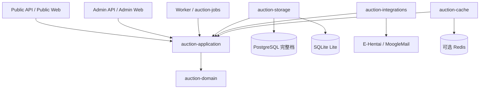

# 系统架构与模块所有权

[文档导航](README.md) · [技术栈](tech-stack.md) · [契约](contracts/README.md) · [验证状态](status.md)

## 本页导航

- [系统边界](#系统边界)
- [Crate 所有权](#crate-所有权)
- [部署档位与能力](#部署档位与能力)
- [命令、事务与事实](#命令事务与事实)
- [Worker 与外部副作用](#worker-与外部副作用)
- [配置与数据保护](#配置与数据保护)
- [浏览器、实时与制品](#浏览器实时与制品)
- [生命周期与运维](#生命周期与运维)

## 系统边界

Auction Rust 在一个 Cargo workspace 内实现领域、用例、数据库适配、HTTP、浏览器及后台任务。
Public、Admin、Worker 独立部署；`auctionctl` 承担配置、迁移和运维。实现与验收不依赖外部源码仓库。
PostgreSQL、SQLite、Redis、反向代理和系统服务作为外部组件，不受仓库全 Rust 语言约束。

图中适配器依赖应用端口；进程装配根负责实例化并注入适配器。领域不读取配置、不执行 SQL、不发起网络调用。
HTTP 负责输入和 DTO 映射，Worker 负责调度，二者都不建立第二套状态机。

## Crate 所有权

| owner | 拥有的事实或边界 | 实现说明 |
| --- | --- | --- |
| auction-domain | 金额、标识、竞价计划、代理转换、拍卖状态与结算守恒 | [README](../crates/auction-domain/README.md) |
| auction-application | 用例、事务编排、命令幂等与窄端口 | [README](../crates/auction-application/README.md) |
| auction-contracts | REST/实时 DTO、错误、分页与版本 | [README](../crates/auction-contracts/README.md) |
| auction-storage | SQL、连接池、锁、账本、追加迁移和后端差异 | [README](../crates/auction-storage/README.md) |
| auction-cache | 可重建数据的 disabled/Redis 适配器 | [README](../crates/auction-cache/README.md) |
| auction-integrations | 论坛、邮件、装备来源、凭据加密与外部证明 | [README](../crates/auction-integrations/README.md) |
| auction-jobs | 持久调度、重试、游标、租约与本机 Worker control | [README](../crates/auction-jobs/README.md) |
| auction-http | 两个 surface 的路由、安全边界、TCP/Unix 绑定与泛型静态响应 | [README](../crates/auction-http/README.md) |
| auction-web-public | Public 页面、路由、API 消费、实时恢复与译文 | [README](../crates/auction-web-public/README.md) |
| auction-web-admin | 管理页面、命令交互、API 消费与译文 | [README](../crates/auction-web-admin/README.md) |
| auction-web-shared | 无业务偏向的组件、传输、格式化、语言与设计变量 | [README](../crates/auction-web-shared/README.md) |
| auction-config | TOML、默认值、校验、cron 与 runtime 文件适配 | [README](../crates/auction-config/README.md) |
| auction-observability | tracing、metrics、健康与心跳安全投影 | [README](../crates/auction-observability/README.md) |
| auction-process | 终止信号、有界 drain 与任务守卫 | [README](../crates/auction-process/README.md) |
| auction-setup | PostgreSQL 单机档的一次性 loopback 初始化 API 与令牌门禁；不参与正式 Admin 路由 | [README](../crates/auction-setup/README.md) |

`apps/*` 只负责配置、依赖注入、资源绑定、关闭顺序和退出码。每个 `src` 根只保留必要 `main.rs`/`lib.rs`，
实现放入具名职责目录。不得用共享大结构体、私有持久化访问或 `common`/`misc` 绕过 owner。
数据库对象、事件和路由的唯一 owner 分别登记在 [schema](contracts/schema.md)、[events](contracts/events.md)和
[routes](contracts/routes.md)。

## 部署档位与能力

敏感 TOML 的 `[database]` 五项连接参数选择 PostgreSQL 完整档，由 `auction-config` 的
`settings/secrets/database.rs` 校验并生成内部 URL；兼容的 `database_url` 按 scheme 选择档位，
两种输入不能混用。对应驱动必须显式编译，不使用 `sqlx::Any` 隐藏差异。

| 能力 | PostgreSQL 完整档 | SQLite Lite |
| --- | --- | --- |
| 拓扑 | 独立进程，具备并发及多进程存储边界；具体扩展需验证 | 单主机，每角色至多一个实例，Worker 并发 1 |
| 关键竞价/生命周期写入 | Serializable、显式行锁、最多三次序列化冲突尝试 | `BEGIN IMMEDIATE` 串行写事务 |
| 竞价、代理、会话与共有审计 | 支持 | 支持已声明子集，正确性不降级 |
| Public 目录、lot、bid-log、账户 | 权威读投影 | 共有投影；装备真实 URL 留空 |
| 成交价格历史、补偿、结算、履约、recovery | 完整事实链 | 不支持；状态列不能充当结算证明 |
| Admin 用户、改名、黑名单、审计 | 支持 | 已实现共有能力 |
| Admin realtime 元数据、lag/failure/replay | 支持 | 已实现共有能力 |
| Admin 规则 | 读取、候选校验与发布 | 只读 |
| runtime 管理命令、world 启停、完整 Admin 录入/报表 | 支持 | 不提供完整档命令；world 目录可读 |
| 外部凭据、论坛、邮件和告警 | 完整档 owner | 不提供对应外部业务链 |
| 持久化生命周期与慢速代理 | 支持；另有结算 workflow | 支持 Lite 阶段，不启用结算 workflow |
| 灾备与 canonical v28 接管 CLI | 显式完整档流程 | 不使用 PostgreSQL 维护流程 |

各路由的具体成功和缺失状态以[HTTP 契约](contracts/routes.md)为准。表中“支持”描述代码能力，不代表运行验收。
新增持久化能力必须先在本表登记完整档、Lite 或两者，再决定迁移与端口范围。
SQLite 文件只能位于受支持的本地文件系统，不能以共享网络文件系统实现扩展。

## 命令、事务与事实

竞价请求携带稳定 `command_id`，在所选后端同一事务内完成账本重放检查、world/auction/lot 与资格保护、
领域计划、竞价事实、状态版本、追加审计和 realtime/outbox。同 ID 不同负载冲突；已接受结果的重放不受当前配置重解释。
公开新出价和代理上限遵守 1B 与金额网格，历史读取及已结算金额不截断。

领域 `CompetitionPlan` 只计算计划。PostgreSQL 的共享门禁锁与 lot 排他锁、SQLite 串行写入分别由存储 owner 执行。
用户黑名单、会话撤销与代理冻结保持锁内资格一致性；慢速代理用持久化 generation/due 校验阻止陈旧执行。
`leader_since` 依据本次所有接受事实判断连续领先，不能只比较事务前后的最终领先者。

生命周期、结算与恢复共享应用入口；预览要求非空待拍标的，Draft/Preview 接收本期录入，Open 才移动 intake target。
拍卖创建冻结经济/结算策略，后续配置不回写快照。人工提前开放/结算默认关闭，能力与锁内校验使用相同启动配置。
结算、补偿和履约遵守金额守恒及证据 fence，所有更正追加新事实。详细规则见[领域不变量](contracts/invariants.md)。

## Worker 与外部副作用

Worker 的 due、游标、尝试、租约和 fencing 由数据库持有。领取可使用队列专属隔离与显式锁，业务命令仍走原事务边界。
配置改变只影响后续调度参数，不修改已冻结轮次和命令身份。关闭业务世界阻止新场次，不取消既有履约与恢复工作。

邮件/论坛写入必须发生在本地提交之后。MoogleMail 处理在批次预算内按连续前缀提交完成证明和 cursor，
随后才能触发取件、退回和通知。主动 ComposeSend 成功要求唯一新增 Sent MID 与精确 payload proof；
未知结果停靠人工对账，不能凭成功页或本地 UUID 重发。论坛未知创建结果先只读对账，重试写入需显式授权。
完整时序见 [Worker](../apps/worker/README.md)、[任务编排](../crates/auction-jobs/README.md)和
[外部适配](../crates/auction-integrations/README.md)。

## 配置与数据保护

三个角色引用同一公共 TOML，各自引用敏感 TOML；Admin/Worker 可共享非敏感 runtime。
runtime 的六组 `operations.*.managed` 默认关闭，保存通过文件锁、fingerprint fence、durable 命令账本和原子替换完成。
文件替换后遇到账本确认失败，保留新文件并向前恢复；生效边界为对应进程重启。
数据库 `worlds.enabled` 与只控制邮件入站的 runtime world 开关是不同事实。

Cookie、会话/数据密钥及 URL 凭据仅由敏感配置和专用加密边界持有。普通日志、事件与审计不得包含密钥。
Public P09/P11 的完整装备 URL 是受限例外：HTTP 核对 equipment owner 后短暂解密，响应 `no-store`；
不进入日志或缓存。邮件审查只返回脱敏展示投影，异常原始证据独立加密保留。
详见[配置](../ops/config/README.md)和[邮件诊断](operations/mail-diagnostics.md)。

缓存默认禁用，目前只加速 Public 规则读取。有限 TTL、总超时和并发上限控制成本；miss、损坏、不可用及失效失败回源。
缓存不能持有资格、锁、会话真值、命令账本或审计。具体预算见[缓存适配器](../crates/auction-cache/README.md)。

## 浏览器、实时与制品

Public/Admin 为分离的 Dioxus CSR SPA，独立路由、译文和产物；共享层只拥有基础能力。
首次部署页由 Admin 的 `operations/setup.rs` 编排，`operations/setup/` 拆分短生命周期草稿、字段
校验、控件与配置提交；不使用普通 Admin 会话，不持久化凭据。数据库与完整配置校验仍由
`auction-setup`/`auction-config` 拥有，浏览器的密码确认和字段提示不扩展配置 DTO。
REST DTO 与 WebSocket v1 由 contracts 定义。事件是重读提示，跳号或重连通过 HTTP Catch-up/权威快照恢复；
当前没有 SSE 路由或外部广播 sink。实时 sequence、版本、帧限制与关闭原因见[事件契约](contracts/events.md)。

五语言固定为 `en`、`zh-CN`、`zh-TW`、`ja`、`ko`，默认 Public `en`、Admin `zh-CN`，偏好键固定 `hv.lang`。
表格使用完整百分比列宽，窄屏保持表结构并提供截断文本查看，见[表格契约](table-layouts.md)。

各 HTTP 装配根拥有自己的 `RustEmbed` 类型，显式 `web-embed` 决定资源集合；API-only 使用固定空集合。
`allow_missing` 让缺失产物可编译并返回 503，不能由机器残留文件决定制品内容。
发布脚本核验两端隔离、payload 哈希、依赖边界与构建源码身份，再生成确定性归档。

## 生命周期与运维

进程通过 `auction-process` 接收 SIGINT/SIGTERM：首次信号停止接收/领取，业务 drain 默认最多 10 秒；
第二次信号或超时强制收口。装配根停止周期心跳后发布 stopping，再按配置限时刷新 tracing。
systemd 示例 `TimeoutStopSec=45` 覆盖业务 drain、最长 30 秒 exporter 刷新与退出余量。

systemd 拥有单进程 PID、信号和重启；`auctionctl deployment` 拥有跨角色配置核对、迁移、
Worker → Admin → Public 启动及反向停止。只读盘点、备份、重建、恢复和 v28 接管是独立命令，
不得进入自动启动路径。具体前提、确认、回执和失败处理见[部署](../ops/deploy/README.md)、
[灾备](../ops/deploy/RECOVERY.md)及[v28 接管](../ops/deploy/LEGACY_V28_ADOPTION.md)。

workspace、`crates/*` 和工程目录组织借鉴 Honk；拍卖行为与验收由本仓库独立拥有。
