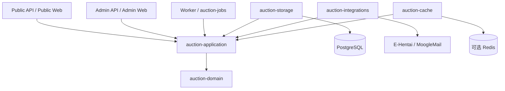

# 系统设计、架构与模块所有权

[文档导航](README.md) · [技术栈](tech-stack.md) · [契约](contracts/README.md) · [验证状态](status.md)

## 本页导航

[owner](#crate-所有权) · [能力矩阵](#部署档位与能力) · [事务](#命令事务与事实) ·
[Worker](#worker-与外部副作用) · [数据保护](#配置与数据保护) · [制品](#浏览器实时与制品) · [运维](#生命周期与运维)

## 系统边界

本页统一系统设计与模块边界：领域独立于传输和存储，业务事实原子提交，命令幂等重放，
外部结果须有证据，Worker 从持久状态恢复。能力缺失明确返回，不能以空数据或示例伪装成功。

Auction Rust 在一个 Cargo workspace 内实现领域、用例、数据库适配、HTTP、浏览器及后台任务。
原生平台仅 Linux x86_64，限制由五个 `apps/*` 装配根的编译期守卫拥有；正式发布 GNU/glibc，
不承诺其他 OS/架构或 musl 发布档。浏览器仍以 `wasm32-unknown-unknown` 构建，不把原生限制放入共享领域/契约。
Public、Admin、Worker 保留独立进程；`auctionctl` 承担配置、迁移和运维。可选
[auction-server](../apps/server/README.md) 复用三个 app 的 lib 入口，以同一个二进制自管三个子进程；
仅该合并制品允许同时包含两端资源，Public/Admin HTTP router 仍按类型隔离资源。默认分体发布不变。
实现与验收不依赖外部源码仓库。
PostgreSQL、Redis、反向代理和系统服务作为外部组件，不受仓库全 Rust 语言约束。



图中适配器依赖应用端口；进程装配根负责实例化并注入适配器。领域不读取配置、不执行 SQL、不发起网络调用。
HTTP 负责输入和 DTO 映射，Worker 负责调度，二者都不建立第二套状态机。

## Crate 所有权

| owner | 拥有的事实或边界 | 实现说明 |
| --- | --- | --- |
| auction-domain | 金额、标识、竞价计划、代理转换、拍卖状态与结算守恒 | [README](../crates/auction-domain/README.md) |
| auction-application | 用例、事务编排、命令幂等与窄端口 | [README](../crates/auction-application/README.md) |
| auction-contracts | REST/实时 DTO、错误、分页与版本 | [README](../crates/auction-contracts/README.md) |
| auction-storage | PostgreSQL SQL、连接池、锁、账本与追加迁移 | [README](../crates/auction-storage/README.md) |
| auction-cache | 可重建数据的 disabled/Redis 适配器 | [README](../crates/auction-cache/README.md) |
| auction-integrations | 论坛、邮件、装备来源、凭据加密与外部证明 | [README](../crates/auction-integrations/README.md) |
| auction-jobs | 持久调度、重试、游标、租约与本机 Worker control | [README](../crates/auction-jobs/README.md) |
| auction-http | 两个 surface 的路由、安全边界、TCP/Unix 绑定、静态响应与 CDN 缓存门禁 | [README](../crates/auction-http/README.md) |
| auction-web-public | Public 页面、路由、API 消费、实时恢复与译文 | [README](../crates/auction-web-public/README.md) |
| auction-web-admin | 管理页面、命令交互、API 消费、论坛只读状态刷新与正文诊断、入站诊断代码的展示说明与译文 | [README](../crates/auction-web-admin/README.md) |
| auction-web-shared | 无业务偏向的组件、传输、格式化、语言与设计变量 | [README](../crates/auction-web-shared/README.md) |
| auction-config | TOML、默认值、校验、cron 与 runtime 文件适配 | [README](../crates/auction-config/README.md) |
| auction-observability | tracing、metrics、健康与心跳安全投影 | [README](../crates/auction-observability/README.md) |
| auction-process | 终止信号、有界 drain 与任务守卫 | [README](../crates/auction-process/README.md) |
| auction-setup | PostgreSQL 单机档的一次性初始化 API、令牌与显式 HTTPS 代理门禁；默认 loopback，不参与正式 Admin 路由 | [README](../crates/auction-setup/README.md) |

`apps/*` 只负责配置、依赖注入、资源绑定、关闭顺序和退出码。每个 `src` 根只保留必要 `main.rs`/`lib.rs`，
实现放入具名职责目录。不得用共享大结构体、私有持久化访问或 `common`/`misc` 绕过 owner。
数据库对象、事件和路由的唯一 owner 分别登记在 [schema](contracts/schema.md)、[events](contracts/events.md)和
[routes](contracts/routes.md)。

## 部署档位与能力

当前只支持 PostgreSQL。敏感 TOML 的 `[database]` 或兼容 `database_url` 由 `auction-config`
校验，两种输入不能混用；字段与 scheme 见[配置说明](../ops/config/README.md)。驱动仍须显式启用 `postgres`。

| 能力 | 实现边界 |
| --- | --- |
| 分体拓扑 | Public、Admin、Worker 独立进程；具备并发及多进程存储边界，具体扩展需验证 |
| 竞价与生命周期 | Serializable、显式行锁、最多三次序列化冲突尝试；持久调度、慢速代理与结算 workflow |
| Public | 目录、lot、bid-log、账户及成交价格、补偿事实的权威投影 |
| Admin | 用户、改名、黑名单、审计、规则、runtime、world、录入/报表及 realtime 运维 |
| 结算与外部系统 | 结算、履约、recovery、凭据、论坛、邮件与告警的独立 owner；论坛目录每帖最多 150 件，续页身份与正文由 storage 持久化 |
| 运维 | 显式灾备、canonical v28 接管；可选 Linux 单主机 supervisor 与确认后的专用空库初始化 |

本表描述源码能力，不代表运行验收；具体输入、成功与缺失状态由[HTTP 契约](contracts/routes.md)拥有。
新增持久化能力先登记范围与 owner，再更新[对象契约](contracts/schema.md)、迁移和端口。

## 核心模型与数据流

- 世界控制业务启停；用户有稳定论坛数字 `showuser` ID、可变显示名/MoogleMail 收件人、状态和版本。
  论坛首次竞价可建立 `forum_only` 主体，但不自动发放登录能力；会话真值保存在数据库。
- 拍卖沿 `Draft → Preview → Live → Final → Settling → Settled` 前进，只有 Draft/Preview 可取消。
  创建时冻结经济、截止、代理和结算策略，后续配置不回写快照。
- `lot_id` 是稳定身份，`lot_number` 是场内顺序，`category_key/category_number` 是公开分类编号；
  撤回/重挂不复用编号。`withdrawn` 保留事实及返还义务，论坛只渲染 `live/sold/unsold`。
- 普通出价、代理上限和慢速代理共用领域计划；新输入遵守 1000 Credits 网格和 1B 上限，历史金额不截断。
  授权、降低、冻结和反超形成追加事实；慢速代理由持久 generation/due 驱动，锁内复核资格、状态和金额。
  精确规则由[不变量契约](contracts/invariants.md)拥有。

```text
command_id + 摘要 → 账本重放/冲突 → 锁定权威对象 → 领域计划
                                                    ↓
                  同事务提交事实、版本、结果、审计及所需事件/outbox
                                                    ↓
                              返回结果 / Worker 执行外部副作用
```

Public/Admin 浏览器经各自 HTTP 入口消费 contracts DTO，Worker 经 jobs 调用同一应用用例；
缓存只加速可重建读取，不能替代事实、锁或命令账本。

## 命令、事务与事实

竞价在一个后端事务内完成 `command_id`/摘要重放检查、world/auction/lot 与资格保护、领域计划、
事实、版本、追加审计及实时事件/outbox。同 ID 不同负载冲突；已接受结果不受当前配置重解释。

| owner | 关键职责 |
| --- | --- |
| domain | `CompetitionPlan`、竞价事实/代理转换/快照一致性、失败原子性、Fast/Slow/Final 共用反超计算 |
| application | 锁内用例顺序；`legacy_ledger` 与 `slow_replay` 校验历史结果与请求的绑定 |
| storage | 后端锁模型、锁后 `occurred_at`、资格/会话一致性、generation/due fence；扫描在 LIMIT 前排除已截止 lot |

拍卖创建冻结经济/结算策略；后续配置不改历史快照。生命周期、结算和恢复共用应用入口，
人工提前开放/结算默认关闭；金额守恒、连续领先时间、录入目标及追加更正见[不变量契约](contracts/invariants.md)。
已有错误事实不会因源码修复自动回填，运行边界见[状态页](status.md)。
Admin/Worker 注入当前新拍卖模板，application 后继计划冻结，storage 保证规则列与快照一致。
Recovery 人工重试投影由 storage 的 recovery_commands owner 维护；Delivery Admin 在同一命令事务调用，不另建状态机。

## Worker 与外部副作用

Worker 只负责持久调度、重试与执行时机。due、游标、attempt、lease、fencing 及命令结果由数据库持有；
队列领取和业务事务各守自己的隔离边界。Final 与调度完成 fence 同事务提交。
`scheduled_rounds.schedule_snapshot` 固定自动排期的本地时区来源；历史及无时区手工轮次保留 UTC 周期。
关闭世界阻止新场次，不取消已有履约/恢复；drain 后各 owner 停止领取。

邮件和论坛副作用在本地提交后执行。入站处理按连续前缀提交完成证明及 cursor；未知外部写入先人工对账，
不能凭本地 UUID 或成功页面重发。流拍/撤拍逐件发送原装备，不能 Return 已取件原邮件。
发送证明、论坛对账、各循环及任务边界分别见[不变量](contracts/invariants.md)、
[Worker](../apps/worker/README.md)、[任务编排](../crates/auction-jobs/README.md)与[外部适配](../crates/auction-integrations/README.md)。

论坛目录按分类及编号稳定排序，每帖最多 150 件，从 #1 连续分页；系统日志位于最后一页之后，用户竞价再从下一楼开始。
历史已开始发布/未知写入主题冻结单页并继续导入；新主题启用分页，不能把旧回帖位置重新解释为目录。
全部固定帖的真实 post ID 保存后才导入命令。application 定义分页端口，integrations 负责渲染/合并目录解析，
jobs 负责顺序发布与对账，storage 的 `forum/catalog.rs` 持久化续页身份和正文；回帖只导入普通 bid。
首帖外部 SVG 倒计时的 URL/文字降级由 integrations `forum/render/countdown.rs` 拥有，只作公开时间投影，
不承担状态迁移或 soft-close 判断，见[集成边界](../crates/auction-integrations/README.md#凭据装配与外部请求)。
读取须证明分页、作者和连续楼层，未知 POST 先按精确标题只读对账，重发须显式授权。
拒绝提示由 jobs 的 `worker/forum/reply/rejection.rs` 拥有；application 定义错误码/本地诊断投影，storage 读取既有账本。
新拒绝按类型分类，旧诊断仅做白名单展示映射；不改竞价规则、拒绝终态或重试门禁，见[外部副作用契约](contracts/invariants.md#i-08-外部写入发生在本地提交之后)。
MoogleMail ComposeSend 先验证空 compose 与完整 Sent baseline，再寻找唯一新增且精确匹配 payload 的 MID；
Take/Return 各有独立动作证明。每种 Cookie 只有一个运行 owner，明确登录失效才标 invalid，不自动换备用 Cookie。

## 配置与数据保护

三角色共享非敏感公共 TOML，分别引用敏感文件；Admin/Worker 可共享 runtime。
配置文件由 `auction-config` 拥有，runtime 保存使用文件锁、fingerprint、持久命令账本与原子替换；
替换后账本确认失败须向前恢复，生效须重启；Admin 恢复结果未知或需人工核对时停止启动，不带旧安全快照监听。
数据库 `worlds.enabled` 与仅控制邮件入站的 runtime world 开关分离。
字段、接管组及恢复流程见[配置说明](../ops/config/README.md)。

| 能力 | owner 与保护边界 |
| --- | --- |
| 凭据与装备链接 | 敏感配置/专属加密适配；日志、事件及审计不记录 secret。P09/P11 核对归属后短暂解密装备 URL，响应 `no-store`，不缓存 |
| 邮件审查 | 只返回安全投影，原始异常证据独立加密，见[诊断说明](../ops/mail-diagnostics.md) |
| A44 Cookie 校验 | application 前后复核版本，storage 返回信封，integrations 执行受限 HTTPS GET；不持久化结果、不取得 Worker 写入所有权、不改 active/invalid |
| Admin 会话 | 启动永久撤销旧会话，token 摘要绑定 actor/secret；数据库保存摘要与撤销状态，重启需重新登录，Public 不受影响 |
| Public 长连接会话 | 应用只读 inspect 端口与 storage 权威查询，HTTP 决定复核周期/预算；不续期，不把真值放 Hub 或缓存 |
| 缓存 | 默认关闭，仅加速 Public 规则；有限 TTL/超时/并发，miss、损坏、不可用及失效失败回源 |

精确鉴权与状态码见[HTTP 契约](contracts/routes.md)，缓存预算见[适配器说明](../crates/auction-cache/README.md)。

Cloudflare → Caddy HTTPS → Unix socket 的可信链由部署配置拥有；Caddy 清洗访客地址头，HTTP 边界只接受
显式受信连接提供的 XFF，不伪造 Unix TCP peer、不从转发头推导 Origin 或 Secure Cookie。
`auction-http` 默认禁止 CDN 保存全部响应，仅精确静态 handler 可放行；这与后端可丢弃缓存无关。
API、会话、管理数据、HTML 与 WebSocket 不缓存，部署规则不得覆盖源站禁止缓存头；见[橙云部署](../ops/README.md#cloudflare-整站代理)。

## 浏览器、实时与制品

Public/Admin 是分离的 Dioxus CSR SPA，各有路由、译文、产物和 HTTP 资源类型；共享层仅提供基础能力。
页面设计分别见 [Public](../crates/auction-web-public/DESIGN.md) 和 [Admin](../crates/auction-web-admin/DESIGN.md)。
五语言与 `hv.lang` 保持稳定；表格列宽、截断和窄屏结构见[表格契约](table-layouts.md)。
Public `surface/pagination/` 拥有统一列表数量、译文、URL 更新与 `preferences.rs` 本地数量偏好；shared `Pager`
及 `components/pager/size.rs` 只提供可选数字分页、有界正整数输入与可访问页码限制，
Admin 默认布局不变。页面范围与展开流水的独立查询键见 [Public 设计](../crates/auction-web-public/DESIGN.md#5-表格与信息密度)。

首次设置 UI 位于 Admin crate，由独立 `auction-setup` 服务提供，不使用正式 Admin 会话或持久化凭据。
浏览器拥有草稿、字段提示与确认；数据库和配置校验仍由 setup/config 执行。端口和周排期通过独立 setup DTO
生成回环 listener 与公共计划，runtime 不接管，不改变已有拍卖或代理信任范围。

REST/WebSocket DTO 由 contracts 拥有。通知只提示重读，跳号/重连走 HTTP Catch-up/权威快照；
当前无 SSE 或外部广播 sink。连接配额与会话撤销属于 HTTP，握手等待与恢复属于浏览器；
精确预算、sequence/version 与关闭原因见[事件契约](contracts/events.md)。

显式 `web-embed` 选择各自资源，API-only 固定空集合；`allow_missing` 保证无产物可编译并返回 503。
发布脚本验证两端隔离、payload 哈希、依赖与源码身份后生成确定性归档，步骤见[部署手册](../ops/README.md)。
GitHub Actions 只拥有调度、缓存及受控下载：默认分支推送或手动运行通过静态检查后调用既有发布脚本，
不复制制品规则、不启动程序或自动部署；下载与保留边界见[CI 说明](../ci/README.md#下载-actions-制品)。

## 生命周期与运维

`auction-process` 提供信号和有界 drain，装配根决定停止顺序：首次 SIGINT/SIGTERM 停止接收/领取，
默认最多 10 秒业务 drain；第二次信号或超时强制收口，再完成心跳和有界 tracing 刷新。

| 部署 | 进程与迁移所有权 |
| --- | --- |
| 分体 | systemd 管单角色 PID/重启；`auctionctl deployment start/restart` 严格停机后迁移，按 Worker → Admin → Public 启动，反向停止。已全部运行时 start 只复核 readiness/回执 |
| 合并 | server bootstrap 管进程树、预检及次序，config 管运行目录；首次明确确认后 storage 在迁移锁内检查专用空库和零其他客户端并初始化。普通启动只验 schema，升级显式 `migrate-managed` |

分体 unit 停止预算 45 秒，合并 unit 为 155 秒；合并不使用分体总控，两种模式不得混用同一数据库。
本机文件锁不证明跨主机隔离。备份、恢复、重建、v28 接管均为独立受控命令，不进入自动启动。
一次性部署码保护独立设置页；检查数据库不建库或迁移，保存只表示配置落盘。只有合并模式的额外确认
才授权专用空库初始化与启动。初始化保留迁移兼容视图、锁和 checksum；终止或保存结果未知时不得自动初始化，失败保留现场。
详细门禁见[部署](../ops/README.md)、[灾备](../ops/deploy/RECOVERY.md)、
[v28 接管](../ops/deploy/LEGACY_V28_ADOPTION.md)及[合并服务](../apps/server/README.md)。
