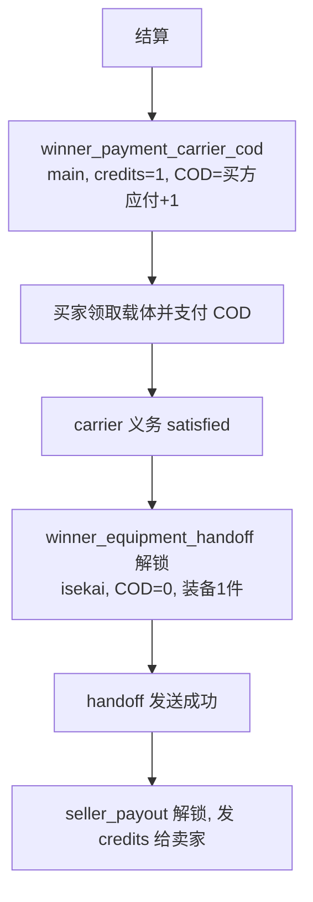

# COD 结算流程与验证

拍卖结束后，结算 Worker 按每件 lot 建立**义务**（`settlement_obligations`），再按义务生成投递（`deliveries`）。
本页说明 COD 邮件的流转、三段验证方法，以及收件人是 Bot 自己时的内部路径。

## 义务与投递形态

| 义务 `kind` | 世界 | 邮件模板 | Credits | COD | 收件人 | 前置义务 |
| --- | --- | --- | --- | --- | --- | --- |
| `winner_equipment_cod` | main | `settlement_winner_equipment_cod` | 0 | 买方应付 | 买家 | 无 |
| `winner_payment_carrier_cod` | main | `settlement_payment_carrier` | 1（载体） | 买方应付+1 | 异世界买家 | 无 |
| `winner_equipment_handoff` | isekai | `settlement_equipment_handoff` | 0 | 0 | 异世界买家 | carrier 实收 |
| `seller_payout` | main | `settlement_seller_payout` | 卖家应得 | 0 | 卖家 | 装备 COD（iseskai 时为 handoff） |
| `buyer_refund` | main | `settlement_buyer_refund` | 金额 | 0 | 买家（contingent） | 装备 COD |
| `unsold_return` / `withdrawn_return` | 原世界 | `settlement_equipment_handoff` | 0 | 0 | 原卖家 | 无 |

买方应付是冻结的 `buyer_amount`，已包含奖惩与额外奖池抵扣。主世界竞得邮件分开列出成交价、费率调整后价格和最终 CoD，
并显示赢家累计领先时长占比及奖惩比例；有奖池抵扣时单列金额。正文与历史任务兼容规则见
[邮件正文模板](ops/config/README.md#邮件正文模板)。

## 主世界成交


## 异世界成交



## 买家退回未付款 COD

买家可以不等付款直接在游戏内把 COD 邮件退回 Bot。退回不算退款，按次数分流：

```mermaid
flowchart TD
  A[买家退回 COD 邮件] --> B[收件箱收到<br/>Subject: Auction equipment delivery [obligation]]
  B --> C[inbound_mail<br/>decision=settlement_recovery_returned]
  C --> D[recovery: stage=reclaiming<br/>cod_return_count += 1]
  D --> E[Worker 从退回邮件领取装备<br/>custody proof 落库]
  E --> F{退回次数}
  F -- 未达上限 --> G[原 COD 投递重置为 pending<br/>履约重新排队, 金额与装备不变]
  G --> H[recovery 回到 awaiting_payment<br/>付款期限重新计算]
  F -- 达到上限 (默认第 3 次) --> I[拉黑买家: 连续N次退回COD邮件]
  I --> J[新建 withdrawn_return 义务<br/>装备寄回卖家]
  J --> K[原 COD 履约 failed / cod_returned_three_times<br/>seller_payout 履约 failed / equipment_returned_to_seller]
  K --> L[recovery completed<br/>resolution=returned_after_three_cod_returns]
```

- 退回识别依赖标题仍为 `Auction equipment delivery [<obligation uuid>]`（或 `Auction payment request`）；标题被改动则不进入 recovery。
- `reclaim_equipment_take` 在每次退回都会重新排队并重新取证；证据不匹配会留在 `reclaiming` 并带 `blocking_code`。
- 退回上限由 `[auction.settlement.recovery] cod_return_limit` 配置（默认 3，范围 1–10），创建 recovery 时冻结。
- 未达上限的退回只重置发送状态，不新增义务、不改金额；卖家收款义务保持 blocked，等买家最终付款。
- 达到上限时原成交作废：COD 与卖家收款义务按失败收口，理由分别为 `cod_returned_three_times` 与
  `equipment_returned_to_seller`；装备以 `withdrawn_return` 寄回卖家，recovery 以
  `returned_after_three_cod_returns` 完成（代码名保留历史含义，实际触发点为配置上限）。
- 买家黑名单只在达到上限时写入，理由是“连续三次退回COD邮件”（配置几次就使用对应中文次数）。
- 发送后只在共享的绝对时间窗口（`worker.fulfillment.evidence_poll_seconds`，默认 300 秒）读取 Sent：同一窗口内所有 COD/货款邮件一起处理，窗口中新增的目标顺延到下一个窗口，不各自计时；全部义务完成后停止。

## 三段验证

| 要验证什么 | 权威证据 | 查询方式 |
| --- | --- | --- |
| COD 邮件是否真的发出 | `deliveries.status='succeeded'` + `external_reference='mooglemail:<world>:send:<mid>'` + `result_metadata.sent_verified=true`；游戏 Sent 箱该 MID | Admin 投递队列；`auctionctl mail-evidence export <evidence_id>`；Worker 日志 `sent_verified` |
| 买家是否收货并付款 | Bot 的 Sent 详情出现 `CoD Paid: <金额>` 回执，`collected=true`；随后 delivery 不再有待领取资产 | Worker 日志 `settlement fulfillment reconciled external Sent/Balance evidence`；`delivery status`/义务状态 |
| 卖家是否收到 Credits | `seller_payout` 投递 `succeeded`，`credits=<卖家应得>`、`cod=0`；游戏 Sent 箱对应 credits 邮件 | Admin 投递队列；卖家游戏邮箱余额 |

`write_unknown` 表示 POST 已经发出、但 Sent 证明未成立：**先核对游戏 Sent 箱**，
确认已发出就不要再 retry（会重复发信），确认未发出才允许 `reconcile → retry`。
`preflight_unproven` / `compose_not_clean` 表示 compose 页有草稿残留，需先清空（无附件、无正文、`Credits: 0`、`COD: 0`）。

## 收件人是 Bot 自己

MoogleMail 无法给自己发信（`recipient_is_sender`），因此义务在领取阶段就分流：

| 义务 | Bot 作为收件人时的内部动作 |
| --- | --- |
| `winner_equipment_cod` / `winner_payment_carrier_cod` | `Purchase`：装备留存，按买方应付内部记账 |
| `winner_equipment_handoff` | `Handoff`：异世界装备直接留存 |
| `unsold_return` | `KeepUnsold`：流拍装备留存，不产生邮件 |
| `seller_payout` | `RetainSeller`：Credits 内部入账 |
| `buyer_refund` | `Refund`：内部退款 |
| `withdrawn_return` | `KeepUnsold`：撤拍装备直接留存 |

分流条件是 MoogleMail 凭据身份 `player_name` 等于义务收件人，**或**收件人命中 Admin runtime
`bot_players`（大小写不敏感）里配置的 bot 显示名。**已经生成外部 delivery 的历史行不会退回内部路径**：
这类行会以 `recipient_is_sender` 进入 `manual_reconcile`，必须人工核对后收口；新配置只影响后续新结算。

买家是 bot 时不会产生 COD 邮件：内部 `Purchase` 直接按买方应付分配资金并解锁 `seller_payout`，
卖家仍按正常 credits 邮件收款（卖家是 bot 时走 `RetainSeller` 内部入账）。

## 已知盲区

- Sent 证明依赖页面结构：附件计数行、`CoD Paid:` 回执行、COD 单行都可能让解析失败，
  一次失败就把“已发出”记录成 `write_unknown`。
- 因此每期结算后建议人工核对一次 Sent 箱：数量、收件人、COD 金额与义务列表逐条对应。
