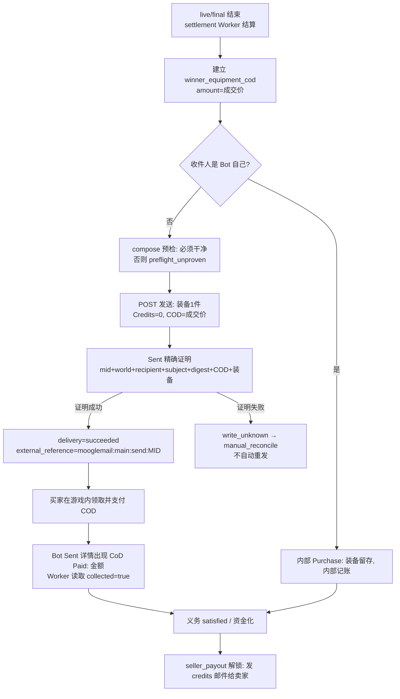
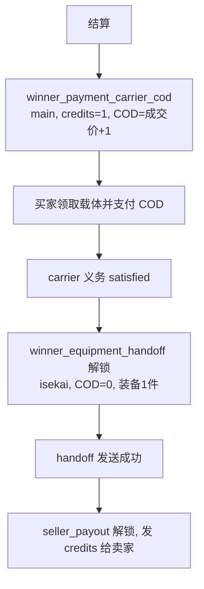

# COD 结算流程与验证

拍卖结束后，结算 Worker 按每件 lot 建立**义务**（`settlement_obligations`），再按义务生成投递（`deliveries`）。
本页说明 COD 邮件的流转、三段验证方法，以及收件人是 Bot 自己时的内部路径。

## 义务与投递形态

| 义务 `kind` | 世界 | 邮件模板 | Credits | COD | 收件人 | 前置义务 |
| --- | --- | --- | --- | --- | --- | --- |
| `winner_equipment_cod` | main | `settlement_winner_equipment_cod` | 0 | 成交价 | 买家 | 无 |
| `winner_payment_carrier_cod` | main | `settlement_payment_carrier` | 1（载体） | 成交价+1 | 异世界买家 | 无 |
| `winner_equipment_handoff` | isekai | `settlement_equipment_handoff` | 0 | 0 | 异世界买家 | carrier 实收 |
| `seller_payout` | main | `settlement_seller_payout` | 卖家应得 | 0 | 卖家 | 装备 COD（iseskai 时为 handoff） |
| `buyer_refund` | main | `settlement_buyer_refund` | 金额 | 0 | 买家（contingent） | 装备 COD |
| `unsold_return` / `withdrawn_return` | 原世界 | `settlement_equipment_handoff` | 0 | 0 | 原卖家 | 无 |

## 主世界成交

## 异世界成交

## 三段验证

| 要验证什么 | 权威证据 | 查询方式 |
| --- | --- | --- |
| COD 邮件是否真的发出 | `deliveries.status='succeeded'` + `external_reference='mooglemail:<world>:send:<mid>'` + `result_metadata.sent_verified=true`；游戏 Sent 箱该 MID | Admin 投递队列；`auctionctl mail-evidence export <evidence_id>`；Worker 日志 `sent_verified` |
| 买家是否收货并付款 | Bot 的 Sent 详情出现 `CoD Paid: <金额>` 回执，`collected=true`；随后 delivery 不再有待领取资产 | Worker 日志 `settlement fulfillment reconciled external Sent/Balance evidence`；`delivery status`/义务状态 |
| 卖家是否收到 Credits | `seller_payout` 投递 `succeeded`，`credits=<卖家应得>`、`cod=0`；游戏 Sent 箱对应 credits 邮件 | Admin 投递队列；卖家游戏邮箱余额 |

`write_unknown` 表示 POST 已经发出、但 Sent 证明未成立：**先核对游戏 Sent 箱**，
确认已发出就不要再 retry（会重复发信），确认未发出才允许 `reconcile → retry`。
`preflight_unproven` / `compose_not_clean` 表示 compose 页有草稿残留，需先清空（无附件、无正文、`Credits: 0`、`COD: 0`）。

## 收件人是 Bot 自己

MoogleMail 无法给自己发信（`recipient_is_sender`），因此义务在领取阶段就分流：

| 义务 | Bot 作为收件人时的内部动作 |
| --- | --- |
| `winner_equipment_cod` / `winner_payment_carrier_cod` | `Purchase`：装备留存，按成交价内部记账 |
| `winner_equipment_handoff` | `Handoff`：异世界装备直接留存 |
| `unsold_return` | `KeepUnsold`：流拍装备留存，不产生邮件 |
| `seller_payout` | `RetainSeller`：Credits 内部入账 |
| `buyer_refund` | `Refund`：内部退款 |
| `withdrawn_return` | `KeepUnsold`：撤拍装备直接留存 |

分流条件是 MoogleMail 凭据身份 `player_name` 等于义务收件人，**或**收件人命中 Admin runtime
`bot_players`（大小写不敏感）里配置的 bot 显示名。**已经生成外部 delivery 的历史行不会退回内部路径**：
这类行会以 `recipient_is_sender` 进入 `manual_reconcile`，必须人工核对后收口；新配置只影响后续新结算。

买家是 bot 时不会产生 COD 邮件：内部 `Purchase` 直接按成交价分配资金并解锁 `seller_payout`，
卖家仍按正常 credits 邮件收款（卖家是 bot 时走 `RetainSeller` 内部入账）。

## 已知盲区

- Sent 证明依赖页面结构：附件计数行、`CoD Paid:` 回执行、COD 单行都可能让解析失败，
  一次失败就把“已发出”记录成 `write_unknown`。
- 因此每期结算后建议人工核对一次 Sent 箱：数量、收件人、COD 金额与义务列表逐条对应。
