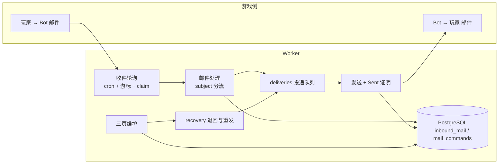
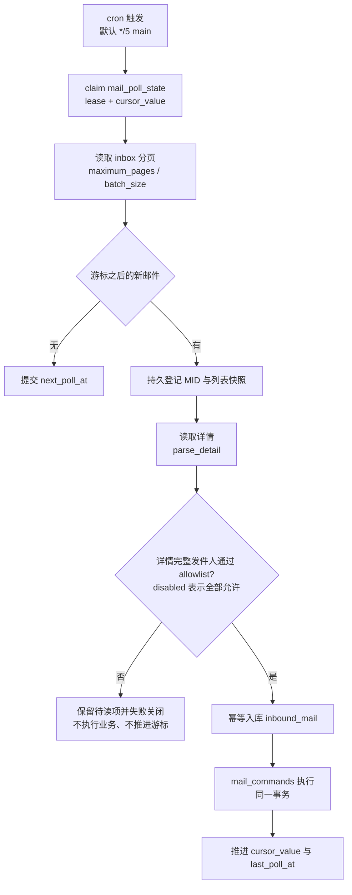
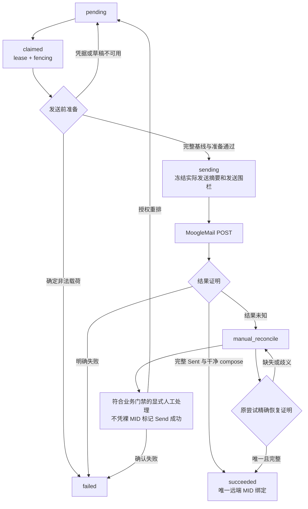
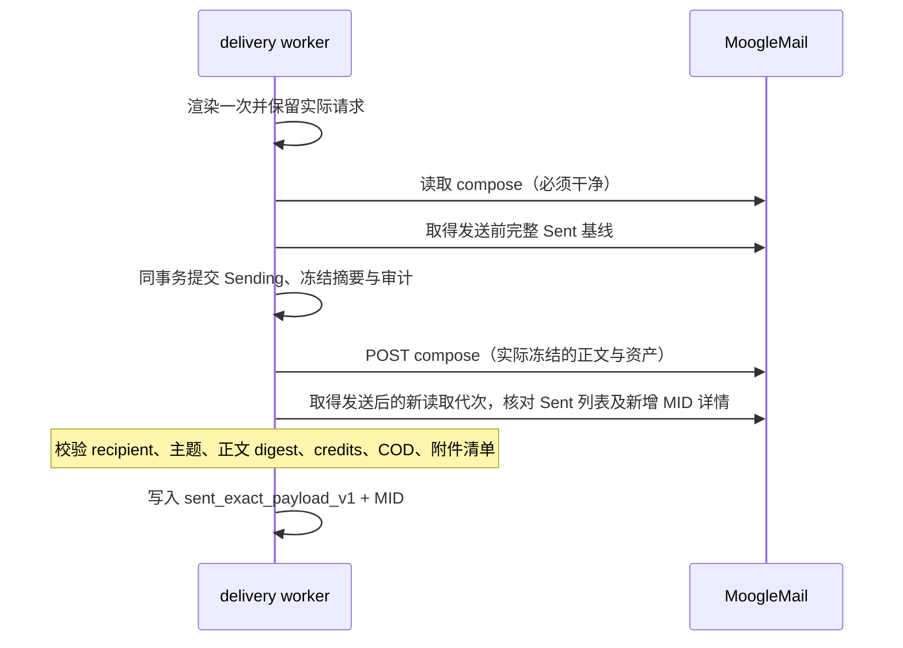
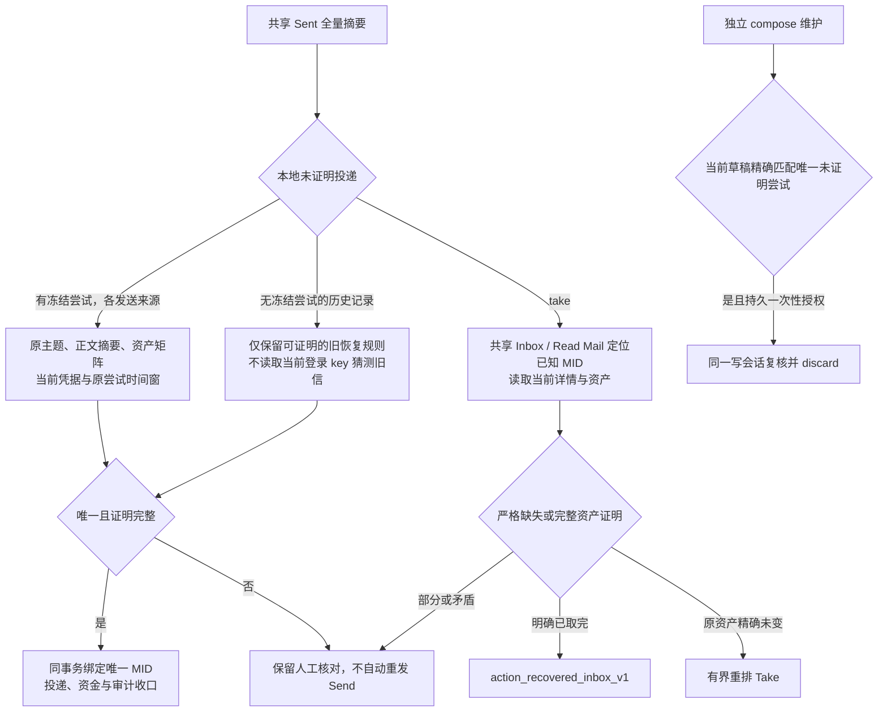
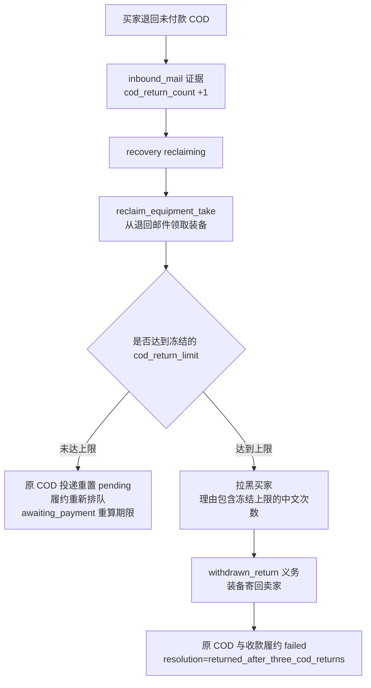

# MoogleMail 全流程

[文档导航](docs/README.md) · [COD 结算细节](docs/guide/cod-settlement-flow.md) · [邮件诊断](ops/mail/diagnostics.md) ·
[不变量](docs/contracts/invariants.md) · [投递与邮箱 schema](docs/contracts/schema.md)

本页给出 Bot 与游戏 MoogleMail 之间全部方向的流程图：收件轮询、业务分流、本地命令、投递队列、发送证明、三页维护与恢复。
金额、义务与 COD 语义以 [COD 结算流程](docs/guide/cod-settlement-flow.md) 为准，本页只描述消息怎么进出、证据怎么成立。

## 1. 总览



三条硬规则：

1. 远端只读与本地写入分离：先解析出 typed envelope，再在本地事务里做幂等命令；外部写入永远在本地提交之后。
2. 发送必须留证据：新发送要求 `sent_exact_payload_v1`（MID + 主题 + 正文摘要 + 资产矩阵）；发送后结果未知时，由恢复路径核对原冻结尝试，不重发邮件。
3. 维护只补证据或重排队，不猜金额、不改义务；金额只能来自持久 obligation/payload。

## 2. 收件轮询



- 游标、失败次数、暂停标记都在 `mail_poll_state`，Worker 重启不丢进度。
- 详情解析失败按分类退避，不会把未知邮件当作成功。
- 列表发件人可能被截断，仅保留在恢复快照中；入站、注册/重绑、回复地址和 allowlist 全部使用详情完整发件人。
- `batch_size` 限制详情候选总数，不再按列表名称预过滤。不在白名单的详情保留待核对并阻断后续处理，
  不领取、退回或回复；调整白名单后仍按原 MID 恢复，不修改旧摘要或手工跳游标。
- 普通收件与三页观察共享绑定凭据、世界和代次的有界读取，不占用 compose/资产操作 guard；写入及资金授权仍持有独占 guard，维护失败不撤销其他路径已提交的事实。

## 3. 收件分流

```mermaid
flowchart TD
  S[subject 小写化<br/>不 trim 首尾] --> A{auction?}
  A -- 是 --> A1[读取附件装备页]
  A1 --> A2{金额/附件/可领取}
  A2 -- 非法 --> A3[退信 + 拒绝通知]
  A2 -- 合法 --> A4[建立 submission 与 lot<br/>auction_accepted]
  A4 --> A5[入队 take 动作<br/>领取附件到 Bot 托管]
  A -- 否 --> R{register / rebind?}
  R -- 是 --> R1[users 命令<br/>register_or_recover / rebind]
  R1 --> R2[通知投递<br/>register_key / register_result / rebind_result]
  R -- 否 --> T{结算退回标题?<br/>Auction equipment delivery / payment request [uuid]}
  T -- 是 --> T1[写入 inbound_mail 证据<br/>decision=settlement_recovery_returned]
  T1 --> T2[recovery 记录退回<br/>reclaiming + 次数 +1]
  T -- 否 --> U[unknown<br/>归档或拒绝资产]
```

- `auction`：只接受零 credits、零 COD、至少一件附件且可领取的邮件；起始价从正文解析，附件逐件读装备页核对。
- 品质是硬性门槛：`equipment_filter.qualities` 默认只允许 `Legendary` 与 `Peerless`，为空也回退这两个值；低于门槛的装备按 `quality_not_allowed` 直接退回并发送拒绝通知，`equipment_filter.enabled` 不能关闭该门槛。
- `register`：登录 key 通知由 `register_key` 模板发出；黑名单/身份冲突回 `register_result`。
- 退回标题只在保留 obligation UUID 时命中；标题被改写的邮件不会进入 recovery。
- 未知标题若带资产，按 `unknown_assets_rejected` 处理，不静默吞掉。

## 4. 投递队列

`deliveries` 是所有出站动作的唯一队列，按 `payload.operation` 区分：

| operation | 来源 | 说明 |
| --- | --- | --- |
| `send` | `mail_intake` | 注册/拒绝/通知类回复，正文由模板+登录 key 渲染 |
| `send` | `settlement` | COD、carrier、handoff、payout、refund、退回卖家 |
| `take` | `mail_intake` / `settlement_recovery_action` | 从入站邮件领取附件 |
| `return` | `mail_intake` | 把非法入站邮件退回发件人 |
| `send` | `operations_alert` / `lot_watch` | 运维告警与竞价提醒 |



- 围栏前先渲染实际正文并取得完整 Sent 基线、干净 compose；准备失败不执行 POST，不以旧草稿干净与否推断历史投递。
- `000061` 持久保存原尝试的完整主题、正文摘要、Credits/COD/装备矩阵；后续发送不重渲染，普通日志不含正文或凭据。
- `sending_at` 是“可能已经写入远端”的围栏；有它就说明不能假设邮件没发。
- `succeeded` 必须同时有 `external_reference` 与有效证明；普通发送不接受人工伪造 MID。
- `take` 的预检必须核对邮件仍在、附件 ID 与 credits/COD 与 payload 一致。

## 5. 发送与证明



- 主题必须与预期**完全相等**；Sent/Inbox 列表按 35 字节截断（多字节处变成 `U+FFFD`），截断标题只能用于定位候选。
- 正文比对使用规范化 digest，正文本身不落库。
- 发送后 compose 必须回到空表单；仍有残留时整次发送记 `write_unknown`，不把已证明的 MID 当作成功。
- 通知类与结算类共用发送器；区别只在 payload 渲染与后续义务推进。

## 6. 三页维护



- 每个已配置世界的 Inbox、Read Mail 与 Sent 维护分别有界运行；一个页面失败不取消其他页面已提交的处理。
- 同一有效观察窗口内的列表和详情共享读取；发送前后、资产写入前后使用新鲜屏障，不把缓存当作业务授权。
- `Read Mail` 是已读邮箱列表，不是邮件详情页；只服务既有待读与动作恢复，不重新执行业务。页面语义参见 [MoogleMail](https://ehwiki.org/wiki/MoogleMail)。
- 绑定不会重发邮件；Sent 零命中不证明未发送。所有新发送来源使用冻结摘要，旧无证明记录不自动升级或重寄。

## 7. COD 支付与货款轮询

COD 履约发送成功后不会立刻结束生命周期：在义务未 satisfied 前，fulfillment loop 只在共享的绝对时间窗口
（`worker.fulfillment.evidence_poll_seconds`，默认 300 秒）读取 Sent 证据。窗口按 epoch 对齐，同一窗口内到期的所有
COD/货款履约一起领取；窗口中途新增的追踪目标等到下一个窗口，不会单独建立五分钟计时。直到出现 `CoD Paid` 回执
（`collected=true`）。买家付款后：

1. COD 履约 `satisfied`，冻结的买家退款保持 contingent；
2. 卖家 `seller_payout` 解锁，按同一投递队列发送 credits；
3. 卖家货款邮件进入同一共享窗口，与其他待追踪邮件一起读取，直到卖家收取；
4. 全部 COD 与货款义务完成后不再有可领取的 fulfillment，轮询自然停止。

已知发送成功 MID 的履约读取按页定位 Sent，命中合法列表行后立即核对详情，不为读取一封已知邮件扫描无关尾页。
履约使用独立新鲜只读轮次，证据不得早于本次 claim，不复用旧共享观察或失效其他读取者。
只有到达尾页仍未命中才能判未观察到；页数耗尽不冒充缺失。仍校验 world、收件人、主题、时间与资产矩阵，
资金实收继续在原独占 session 和原 30 秒期限内复核；新发送基线、未知候选搜索和新增唯一证明不使用这条捷径。

失败、远端暂不可用、证据漂移仍按普通 `retry_delay_seconds` 重试；只有“邮件已发出但对方还没领取”使用 5 分钟节奏。

## 8. COD 退回



- 退回上限在 `[auction.settlement.recovery] cod_return_limit` 配置（默认 3，范围 1–10），创建 recovery 时冻结。
- 黑名单理由随冻结次数生成，例如默认三次为“连续三次退回COD邮件”。
- `cod_returned_three_times` / `returned_after_three_cod_returns` 保留历史代码名；实际触发点为冻结上限，不固定为第三次。
- Bot 作为买家时不发装备 COD，直接走内部资金把 credits 结给卖家；Bot 作为卖家时不发货款信，直接 COD 装备给买家。
- 流拍、撤拍和退回装备统一生成 `unsold_return` / `withdrawn_return` 义务，由投递队列自动寄回卖家。

细节与金额见 [COD 结算流程](docs/guide/cod-settlement-flow.md)。

## 9. 证据与排错入口

| 想知道 | 看哪里 |
| --- | --- |
| 邮件是否被收下/为什么拒绝 | `inbound_mail.status/decision_code`、Worker 日志、[诊断页](ops/mail/diagnostics.md) |
| 是否真的寄出 | `deliveries.status='succeeded'` + `external_reference` + `result_metadata.proof` + 游戏 Sent 箱 |
| 为什么卡在人工 | `delivery.result_metadata.category`、`failure_code`、recovery `blocking_code` |
| 解析是否漂移 | 加密诊断证据 `evidence_id`、`auctionctl mail-evidence export` |
